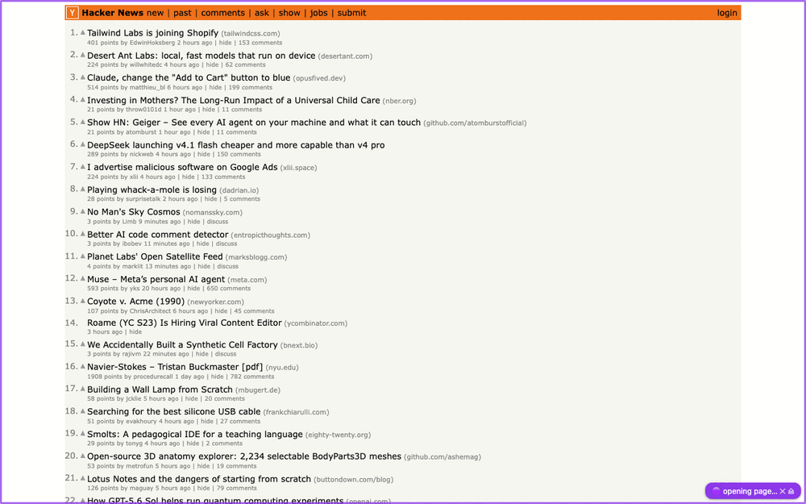
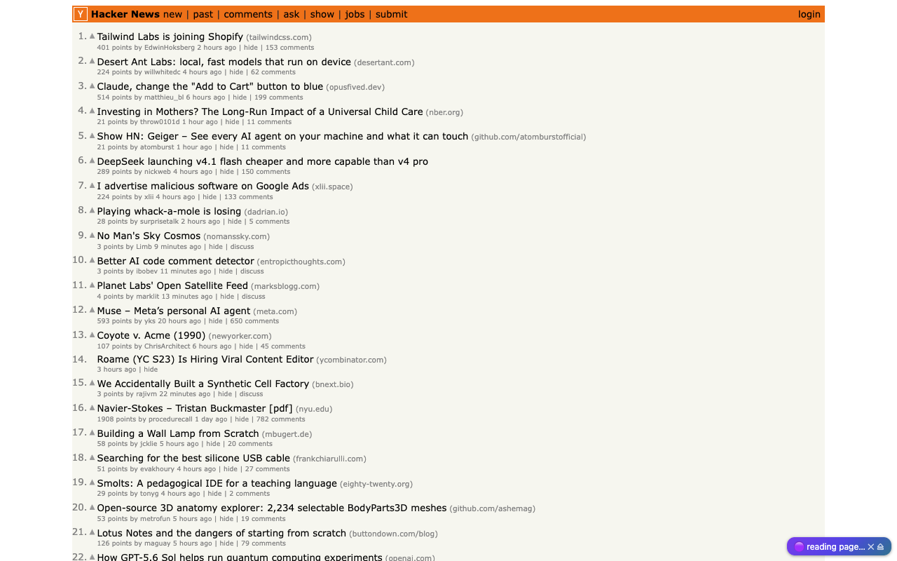

<p align="center"></p>

# chrome-bridge

**English** | [中文](README.zh-CN.md)

[](LICENSE) [](https://nodejs.org) [](package.json)

Let **any AI agent** drive the Chrome you're already using: your real profile, already logged in, with your open tabs, cookies and SSO. It's one small extension plus one zero-dependency Node CLI. Anything that can run a shell command can use it, with no separate browser and no MCP server to configure. Every tab the agent touches wears a 🟣 pill that shows what it's doing.



**[Install from the Chrome Web Store](https://chromewebstore.google.com/detail/chrome-bridge/kmhjlnokjigmnimgjjmiahlinjbcebkg)**, or `git clone` this repo and load the unpacked folder.

## Quick start

Needs macOS or Linux (Git Bash on Windows), Chrome ≥ 117 and Node ≥ 18.

**Chrome Web Store (easiest).** Install the extension, click its toolbar button, choose **Copy setup prompt for your AI agent**, and paste the prompt to your agent (Claude Code, Cursor, …). The agent downloads the bridge, starts it, checks the connection and reports back. The popup shows ● bridge ready when it's done.

**From source.** Tell your agent:

```text
read https://raw.githubusercontent.com/siropkin/chrome-bridge/master/docs/agent-setup.md and do what it says
```

It clones the repo, starts the bridge and sets up its own integration. Then it asks you for the one step Chrome won't let a script do: open `chrome://extensions`, turn on Developer mode, click **Load unpacked** and pick the `extension/` folder. Skip that step if you installed from the Web Store. Loading both copies makes every command ask for `--profile`.

<details>
<summary>Agent can't open URLs? Paste this prompt instead</summary>

````text
Set up chrome-bridge — the bridge that lets you drive my real, logged-in Chrome — and install your end of it. Do every step yourself and tell me the result of each. The only thing I do is the one-time extension load in Chrome (step 3).

1. Pick the repo root `<repo>`:
   - if your working directory is already a chrome-bridge checkout (it contains `cli.mjs` and `AGENTS.md`), use it;
   - else if `~/chrome-bridge/cli.mjs` exists, run `git -C ~/chrome-bridge pull --ff-only` (if the pull fails, show me the error and keep the existing copy) and use `~/chrome-bridge`;
   - else clone it and use `~/chrome-bridge`:

     ```
     git clone https://github.com/siropkin/chrome-bridge.git ~/chrome-bridge
     ```

     (if the clone fails — e.g. `~/chrome-bridge` exists with other content — show me the error and stop; don't delete or move anything)

   Substitute `<repo>` with the real path everywhere below.

2. Bring the bridge up on this checkout's code (needs Node ≥ 18 — if Node is missing or older, tell me and stop; don't install or upgrade anything yourself):

   ```
   node <repo>/cli.mjs stop
   node <repo>/cli.mjs start
   node <repo>/cli.mjs health
   ```

   (`stop` reporting "nothing was running" is fine; the stop-then-start pair guarantees the server runs the code you just fetched, not some older copy from another location — a loaded extension reconnects on its own.)

   - health prints a ⚠ line saying the loaded extension's version differs from the repo → run `node <repo>/cli.mjs extreload` (reloads the extension from disk), then re-run health; if the warning persists, ask me to reload the extension at `chrome://extensions`.
   - health reports `"extension":true` (with no ⚠) → jump to step 4.
   - health reports `"extension":false` → step 3. But if the extension was connected before your restart, wait ~10s and re-run health once first — it reconnects on its own after a server restart.
   - server won't start → show me the error and the last lines of `<repo>/server.log` (if it exists), then stop.

3. The one click only I can do — unless I installed Chrome Bridge from the [Chrome Web Store](https://chromewebstore.google.com/detail/chrome-bridge/kmhjlnokjigmnimgjjmiahlinjbcebkg), in which case skip this step entirely: the store copy connects on its own, and loading the unpacked folder too creates a second profile seat that makes every command demand `--profile`. Otherwise: ask me to open `chrome://extensions`, enable Developer mode, click Load unpacked, and select the `<repo>/extension` folder. On macOS you may run `open -a "Google Chrome" "chrome://extensions"` first. Then poll `node <repo>/cli.mjs health` every 5s (up to ~90s) until it reports `"extension":true`; if it doesn't, tell me what's still missing and stop — don't keep polling.

4. Install your integration — pick the ONE that applies to you:
   - Claude Code — link the skill so it auto-loads on browser tasks in every project and tracks every repo update (use `./.claude/skills/` instead of `~/.claude/skills/` only if I told you to scope it to this project):

     ```
     rm -rf ~/.claude/skills/chrome-bridge && mkdir -p ~/.claude/skills && ln -s <repo>/.claude/skills/chrome-bridge ~/.claude/skills/chrome-bridge
     ```

     (without the trailing slash, `rm -rf` removes only an old symlink or copy, never the repo. On Windows / Git Bash without symlink rights, fall back to `cp -r <repo>/.claude/skills/chrome-bridge ~/.claude/skills/` — and re-copy after every update, a copy goes stale)

   - any other agent (Cursor, Qwen, GLM, Kimi, …) — append this line to the instructions file you read at session start (`CLAUDE.md`, `AGENTS.md`, `.cursorrules`, …; create it in the project you're working in if none exists), but only if it's not already there. If your instructions live somewhere you can't edit, print the line and tell me to paste it there:

     ```
     To drive my Chrome browser (real logged-in tabs), read <repo>/AGENTS.md and run `node <repo>/cli.mjs <command>`. If the health check fails, run `node <repo>/cli.mjs start`; it waits briefly for an already-loaded extension to reconnect. If health still reports the extension disconnected afterward, tell me to reload it.
     ```

5. Tell me the bridge is up. From the next session your integration auto-loads; in this one, read `<repo>/AGENTS.md` when a browser task comes up.
````

</details>

**By hand.**

```bash
git clone https://github.com/siropkin/chrome-bridge && cd chrome-bridge && ./install.sh
```

Load the `extension/` folder as described above, then point your agent at [AGENTS.md](AGENTS.md), the full operating manual.

Check that it worked: `node cli.mjs health` should print `{"ok":true,"extension":true}`. You won't see anything in Chrome until the agent sends its first command; that's normal. To point the agent at one exact tab, use **Copy tab reference** in the toolbar popup and paste the `id:…` it gives you.

If chrome-bridge works for you, a [★ rating on the Chrome Web Store](https://chromewebstore.google.com/detail/chrome-bridge/kmhjlnokjigmnimgjjmiahlinjbcebkg) helps other people find it.

## How it works

The extension connects to a small local server on `127.0.0.1:9333`. Your agent drives it through the CLI:

```bash
node cli.mjs snap localhost:8082         # the page as a compact tree with element refs
node cli.mjs click localhost:8082 @e4    # click by ref
node cli.mjs fill localhost:8082 @e2 "hello@example.com"
node cli.mjs shot localhost:8082 out.png # screenshot, only when pixels matter
```

A `snap` shows the page as a short text tree. The agent can limit it to one part of the page or get only what changed since the last snap, and it acts on the `@e` refs instead of guessing pixel coordinates:

```
table "Hacker News new | past | comments | ask | show | jobs | submit" @e1
  link "Hacker News" @e5
  link "new" @e6
  link "submit" @e12
table "1. Playa Phone (playaphone.com) 122 points by cutoff 1 hour…" @e14
  link "Playa Phone" @e16
  link "41 comments" @e21
```

Writing your own agent loop? Skip the CLI and send JSON to `POST http://127.0.0.1:9333/cmd`, for example `{"type": "snap", "urlMatch": "…"}`.

## What people use it for

- "Check my dashboard every morning and post the change to Slack." A cron-launched agent uses the tab that's already logged in. If a login wall shows up, `wait --human` hands the tab to you.
- Fill a CMS from a CSV without logging in again.
- Compare a staging build against the Figma mockup. [design-eye.md](design-eye.md) is the checklist, and there's an 8px alignment grid overlay.
- See a page in a mobile view without resizing your window: `emulate <tab> 390 844 mobile`.
- Anything where a fresh browser gets stuck and yours doesn't: SSO, bot checks, internal dashboards behind a VPN.

A real run, checked live on GitHub: [recipes/github.com.md](recipes/github.com.md) sets a repo's social preview image.

## You stay in control

- **Every tab the agent touches wears a 🟣 pill**, including tabs it only reads. The pill shows what's happening right now (`🟣 taking screenshot…`) and keeps a history of past actions. Driven tabs also join a 🟣 tab group, which a page can't fake.
- **⏏ on the pill disconnects the agent from that tab.** This is enforced: the bridge refuses every further command on that tab until the agent takes it back with `mark`, and the agent is told to ask you first.
- **The toolbar popup releases the current tab, or every agent tab at once.**
- **`node cli.mjs watch`** prints every command live in your terminal.



## How it compares

Checked 2026-09-12 against each tool's own docs. "—" means the tool doesn't list that feature.

| | chrome-bridge | playwright-mcp | Chrome DevTools MCP | Browser MCP / mcp-chrome | Claude for Chrome |
|---|---|---|---|---|---|
| Drives your real logged-in Chrome | the only mode | opt-in (extension / debugging-port attach) | opt-in (`--autoConnect`, Chrome 144+) | no — launches its own browser | yes, but only from the Claude app |
| Needs an MCP-capable client + server config | no | yes | optional (ships a CLI) | yes | n/a |
| Works with any agent that runs shell commands | yes | MCP clients | MCP clients | MCP clients | Claude app only |
| You watch and can veto while it runs | 🟣 pill narrating live, action history, one-click disconnect (enforced) | — | — | — | — |

### chrome-bridge vs Playwright and playwright-mcp

Playwright drives a browser it launched, with a profile of its own, so the agent starts every session logged out. Attaching to your own Chrome is possible but opt-in. chrome-bridge borrows Playwright's best idea, accessibility-tree snapshots with element refs, and skips the 40 MB dependency.

### chrome-bridge vs MCP browser bridges, Chrome DevTools MCP, and Claude for Chrome

MCP bridges need an MCP client and a configured server. Chrome DevTools MCP can attach to your profile (`--autoConnect`, Chrome 144+), but it's built for DevTools depth (performance traces, debugging). Claude for Chrome works only from the Claude app and reads pages through screenshots. Cloud browsers like Browserbase don't have your logins.

### Chrome 136 broke copying (or reusing) your Chrome profile

Since Chrome 136 (May 2025), Chrome ignores `--remote-debugging-port` on your default profile, and a copied profile loses its logins ("Failed to decrypt", "Chrome is already in use"). chrome-bridge runs inside the Chrome you already have open, so none of that applies: no debugging port, no profile copy, no relaunch.

## Security

You're giving an agent your logged-in browser, so the design assumes you want to watch it work.

- **Local only.** The server listens on `127.0.0.1` and rejects requests that come from web pages, so a site you visit can't drive it. **Any local process can**, though. Unload the extension at `chrome://extensions` when you're not using it.
- **Readable code.** The whole extension is one unminified file (`extension/background.js`) plus a manifest. The Web Store build is the same files.
- **Page content is untrusted.** Anything the bridge returns may contain prompt injection; the rules agents follow are in [AGENTS.md](AGENTS.md). Be careful with `upload`: it reads any local file the agent names into the page. Never let a page decide what gets attached.
- **Exported history leaves out secrets.** `history --batch` comments out typed and pasted text, dialog answers and upload paths.
- **Some commands attach Chrome's debugger.** `net`, `emulate`, `shot`, `upload` and `dialog` do. While they run, Chrome shows its "started debugging this browser" bar, which goes away when the command finishes. Pages can detect the debugger, and anti-bot systems may flag the session. `snap`, `click`, `fill`, `eval` and the other commands don't attach it.

## Commands

Commands that work on a tab take a `<match>`: part of the tab's URL or title, or an exact `id:<tabId>`. The full reference, with every flag and gotcha, is in [AGENTS.md](AGENTS.md#commands).

- **Read:** `snap` · `shot` · `measure` · `perf` · `console` · `net` · `fetch` · `eval` · `ask`
- **Act:** `click` · `fill` · `type` · `paste` · `press` · `hover` · `drag` · `scroll` · `upload` · `clear` · `dialog`
- **Tabs:** `tabs` · `open` · `nav` · `close` · `activate` · `wait` (`--human` hands a tab to you)
- **Device view:** `emulate` · `unemulate` · `resize` · `grid`
- **Housekeeping:** `mark` · `release` · `note` · `watch` · `history` · `doctor` · `batch`
- **Server:** `start` · `stop` · `health` · `profiles` · `extreload` · `swlogs`

## Install detail

<details>
<summary>Upgrades, port, Windows, several Chrome profiles</summary>

**Upgrading.** After `git pull`, restart the server and reload the extension. The old server keeps running the old code, and `health` still passes, so nothing else reminds you:

```bash
node cli.mjs stop && node cli.mjs start
node cli.mjs extreload
```

`health` warns when the loaded extension is older than the repo.

**Server stopped.** If the server dies or the machine reboots, the agent's health check fails and the agent restarts it with `node cli.mjs start`.

**Port.** Everything uses `127.0.0.1:9333`. `BRIDGE_PORT` moves the server and CLI, but the extension always connects to 9333, so you'd have to edit `extension/background.js` too. If `server.log` shows `EADDRINUSE`, something else holds 9333: find it with `lsof -i :9333`. It's often an old server from another checkout; `node <that-repo>/cli.mjs stop` frees it.

**Windows.** `install.sh` needs bash (Git Bash works). The bridge itself is plain Node, so `node server.mjs` and every `cli.mjs` command work anywhere.

**Several Chrome profiles.** Load the extension in each one; agents can drive them in parallel. If a tab match exists in more than one profile, the command is refused until the agent names one with `--profile <name>` (`cli.mjs profiles` lists them). That way the agent never clicks in your personal browser when it meant the work one. Don't load the Web Store build and the unpacked folder in the same profile; the bridge refuses that too and tells you to remove one.

**AI features.** `ask`, `snap --find` and `console --ask` use Chrome's built-in Gemini Nano and need Chrome ≥ 138.

</details>

## Development

`node test/selftest.mjs` runs an end-to-end check against a fake extension (no Chrome needed). CI runs it on every push. How to land changes (version bumps, tags, style) is in the *Developing* section of [AGENTS.md](AGENTS.md).

The npm package is [`@siropkin/chrome-bridge`](https://www.npmjs.com/package/@siropkin/chrome-bridge): `npx @siropkin/chrome-bridge` clones this repo into `~/.chrome-bridge` and starts it. The unscoped `chrome-bridge` package on npm is an unrelated project. To pin a version, check out a tag (`git tag -l`).

## License

MIT
