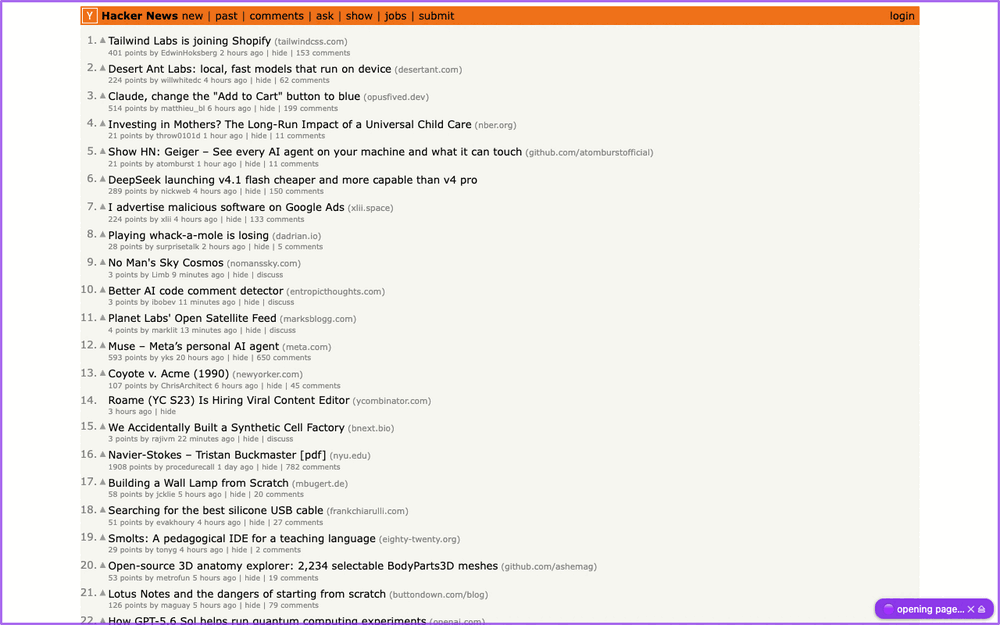
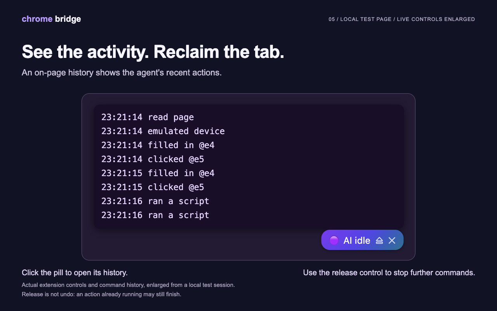

# chrome-bridge

[English](README.md) | **中文**

[](LICENSE) [](https://nodejs.org) [](package.json)

一个小型开源 CLI 桥接器,让**能执行 shell 命令的 AI 智能体**操作你正在使用的 Chrome:已有标签页、登录会话和 SSO。一个 Chrome 扩展连接到本地 Node 服务器和 CLI,没有第三方运行时依赖,不需要另起浏览器或配置 MCP 服务器。被驱动的标签页显示 🟣 小标签,播报当前操作并保留操作历史。

可用于检查页面、验证用户流程、填写表单,或排查网络和性能问题。桥接连接在本地,但**你选择的 AI 智能体可能会把收到的页面内容发送给模型提供商**。复用现有浏览器和 CLI 自动化并非 Chrome Bridge 独有;请参阅[使用取舍](#对比一览)。



**[从 Chrome 应用商店安装](https://chromewebstore.google.com/detail/chrome-bridge/kmhjlnokjigmnimgjjmiahlinjbcebkg)**,或 `git clone` 本仓库后加载解压的扩展文件夹。

## 快速开始

需要 macOS 或 Linux(Windows 上用 Git Bash)、Chrome ≥ 117 和 Node ≥ 18。

**Chrome 应用商店(最简单)。** 安装扩展,点击工具栏按钮,选择 **Copy setup prompt for your AI agent**,把这段提示粘贴给你的智能体(Claude Code、Cursor……)。智能体会下载桥接器、启动服务、检查连接并向你汇报。完成后弹窗会显示 ● bridge ready。

**从源码安装。** 告诉你的智能体:

```text
read https://raw.githubusercontent.com/siropkin/chrome-bridge/master/docs/agent-setup.md and do what it says
```

它会克隆仓库、启动桥接服务并装好自己的接入端。然后它会请你完成 Chrome 不允许脚本代劳的那一步:打开 `chrome://extensions`,开启开发者模式,点击**加载已解压的扩展程序**,选择 `extension/` 文件夹。如果你是从应用商店安装的,跳过这一步。两份都加载的话,每条命令都会要求 `--profile`。

<details>
<summary>智能体打不开网址?改为粘贴这段提示</summary>

````text
Set up chrome-bridge — the bridge that lets you drive my real, logged-in Chrome — and install your end of it. Do every step yourself and tell me the result of each. The only thing I do is the one-time extension load in Chrome (step 3).

1. Pick the repo root `<repo>`:
   - if your working directory is already a chrome-bridge checkout (it contains `cli.mjs` and `AGENTS.md`), use it;
   - else if `~/chrome-bridge/cli.mjs` exists, run `git -C ~/chrome-bridge pull --ff-only` (if the pull fails, show me the error and keep the existing copy) and use `~/chrome-bridge`;
   - else if `~/.chrome-bridge/cli.mjs` exists (an npm install), update and use it the same way (`git -C ~/.chrome-bridge pull --ff-only`, then `~/.chrome-bridge`);
   - else clone it and use `~/chrome-bridge`:

     ```
     git clone https://github.com/siropkin/chrome-bridge.git ~/chrome-bridge
     ```

     (if the clone fails — e.g. `~/chrome-bridge` exists with other content — show me the error and stop; don't delete or move anything)

   Substitute `<repo>` with the real path everywhere below.

2. Bring the bridge up on this checkout's code (needs Node ≥ 18 — if Node is missing or older, install it: macOS `brew install node`, Linux your package manager, Windows nodejs.org; if installing needs a password or fails, tell me and stop):

   ```
   node <repo>/cli.mjs stop
   node <repo>/cli.mjs start
   node <repo>/cli.mjs health
   ```

   (`stop` reporting "nothing was running" is fine; the stop-then-start pair guarantees the server runs the code you just fetched, not some older copy from another location — a loaded extension reconnects on its own.)

   - health prints a ⚠ line saying the loaded extension's version differs from the repo → run `node <repo>/cli.mjs extreload` (reloads the extension from disk), then re-run health; if the warning persists, ask me to reload the extension at `chrome://extensions`.
   - health reports `"extension":true` (with no ⚠) → jump to step 4.
   - health reports `"extension":false` → step 3. But if the extension was connected before your restart, wait ~10s and re-run health once first — it reconnects on its own after a server restart.
   - server won't start → show me the error and the last lines of `<repo>/server.log` (if it exists), then stop.

3. The one click only I can do — unless I installed Chrome Bridge from the [Chrome Web Store](https://chromewebstore.google.com/detail/chrome-bridge/kmhjlnokjigmnimgjjmiahlinjbcebkg), in which case skip this step entirely: the store copy connects on its own, and loading the unpacked folder too creates a second profile seat that makes every command demand `--profile`. Otherwise: ask me to open `chrome://extensions`, enable Developer mode, click Load unpacked, and select the `<repo>/extension` folder. On macOS you may run `open -a "Google Chrome" "chrome://extensions"` first. Then poll `node <repo>/cli.mjs health` every 5s (up to ~90s) until it reports `"extension":true`; if it doesn't, tell me what's still missing and stop — don't keep polling.

4. Install your integration — pick the ONE that applies to you:
   - Claude Code or GitHub Copilot in VS Code (both load skills from `~/.claude/skills`) — link the skill so it auto-loads on browser tasks in every project and tracks every repo update (use `./.claude/skills/` instead of `~/.claude/skills/` only if I told you to scope it to this project):

     ```
     rm -rf ~/.claude/skills/chrome-bridge && mkdir -p ~/.claude/skills && ln -s <repo>/.claude/skills/chrome-bridge ~/.claude/skills/chrome-bridge
     ```

     (without the trailing slash, `rm -rf` removes only an old symlink or copy, never the repo. On Windows / Git Bash without symlink rights, fall back to `cp -r <repo>/.claude/skills/chrome-bridge ~/.claude/skills/` — and re-copy after every update, a copy goes stale)

   - any other agent (Cursor, Qwen, GLM, Kimi, …) — append this line to the instructions file you read at session start (`CLAUDE.md`, `AGENTS.md`, `.cursorrules`, …; create it in the project you're working in if none exists), but only if it's not already there. If your instructions live somewhere you can't edit, print the line and tell me to paste it there:

     ```
     To drive my Chrome browser (real logged-in tabs), read <repo>/.claude/skills/chrome-bridge/SKILL.md and run `node <repo>/cli.mjs <command>`. If the health check fails, run `node <repo>/cli.mjs start`; it waits briefly for an already-loaded extension to reconnect. If health still reports the extension disconnected afterward, tell me to reload it.
     ```

5. Tell me the bridge is up. From the next session your integration auto-loads; in this one, read `<repo>/.claude/skills/chrome-bridge/SKILL.md` when a browser task comes up.
````

</details>

**手动安装。**

```bash
git clone https://github.com/siropkin/chrome-bridge && cd chrome-bridge && ./install.sh
```

按上面的方法加载 `extension/` 文件夹,然后按 `install.sh` 的提示连接智能体:链接 skill(Claude Code、VS Code 中的 Copilot),或让其他智能体去读 [SKILL.md](.claude/skills/chrome-bridge/SKILL.md)——操作手册。

验证:`node cli.mjs health` 应输出 `{"ok":true,"extension":true}`。在智能体发出第一条命令之前,Chrome 里不会有任何变化,这是正常的。想让智能体操作某个确定的标签页,在工具栏弹窗里点 **Copy tab reference**,把得到的内容(`id:… --profile <名称>`)粘贴给它。弹窗里的 **Profile:** 一行显示智能体对当前 Chrome 配置文件使用的名称——智能体问你用哪个配置文件时,看这里即可。

如果 chrome-bridge 对你有用,请在 [Chrome 应用商店留个 ★ 评价](https://chromewebstore.google.com/detail/chrome-bridge/kmhjlnokjigmnimgjjmiahlinjbcebkg),帮助更多人找到它。

## 工作原理

扩展连接到 `127.0.0.1:9333` 上的一个本地小服务器。智能体通过 CLI 驱动它:

```bash
node cli.mjs snap localhost:8082         # 页面变成一棵带元素引用的紧凑树
node cli.mjs click localhost:8082 @e4    # 按引用点击
node cli.mjs fill localhost:8082 @e2 "hello@example.com"
node cli.mjs shot localhost:8082 out.png # 截图,只在需要像素时用
node cli.mjs shot localhost:8082 pr.png --max 0  # 原始分辨率截图,用于 PR 或聊天
```

`snap` 把页面变成一棵简短的文本树。智能体可以只看页面的某一部分,或只取上次快照之后的变化,并直接操作其中的 `@e` 引用,不用猜像素坐标。挡住页面的对话框(例如 Cookie 同意横幅)总会出现在树里,即使页面大到无法完整列出:

```
table "Hacker News new | past | comments | ask | show | jobs | submit" @e1
  link "Hacker News" @e5
  link "new" @e6
  link "submit" @e12
table "1. Playa Phone (playaphone.com) 122 poin… hide | 41 comments" @e14
  link "Playa Phone" @e16
  link "41 comments" @e21
```

自己写智能体循环?可以跳过 CLI,直接向 `POST http://127.0.0.1:9333/cmd` 发送 JSON,例如 `{"type": "snap", "urlMatch": "…"}`。

## 示例工作流

- "每天早上看一眼我的仪表盘,把变化发到 Slack。"cron 启动的智能体直接用已登录的标签页。遇到登录墙时,`wait --human` 会把标签页交给你。
- 从 CSV 填写 CMS,不用重新登录。
- 对照 Figma 设计稿检查 staging 构建。[设计稿对照流程](.claude/skills/chrome-bridge/reference/recipes.md#compare-implementation-vs-mockup) 是检查清单,还有 8px 对齐网格叠加层。
- 不调整窗口大小就能看页面的移动端视图:`emulate <tab> 390 844 mobile`。
- 在已有登录会话中工作,包括 SSO 和 VPN 后面的内部仪表盘。这不会绕过登录验证或反机器人限制。

一次在 GitHub 上实测的真实运行:[recipes/github.com.md](recipes/github.com.md) 设置仓库的社交预览图。

## 你始终掌控

- **智能体触碰的每个标签页都戴 🟣 小标签**,只读的标签页也不例外。小标签显示当前正在做什么(`🟣 taking screenshot…`),并保留历史操作记录。被驱动的标签页还会加入 🟣 标签页分组,页面无法伪造它。
- **小标签上的 ⏏ 会断开智能体对该标签页的控制。** 桥接会拒绝后续命令,直到显式执行 `mark`;智能体的操作说明要求重新接管前先征得你的同意。已经开始的操作仍可能完成。这是工作流控制,不是防范恶意本地智能体的安全边界。
- **工具栏弹窗可以释放当前标签页,或一次释放所有智能体标签页。**
- **`node cli.mjs watch`** 在终端里实时显示每条命令。



## 对比一览

依据下方链接的官方文档核对于 2026-11-05。这是工作流取舍,不是排名或性能基准。

| 方案 | 适用场景 |
|---|---|
| **Chrome Bridge** | 小型 MIT 开源扩展加本地 Node 服务器/CLI,没有第三方运行时依赖。围绕已有 Chrome 标签页、shell 命令、局部/差量快照、页内操作播报和显式配置路由设计。 |
| **[Playwright 扩展 + MCP](https://github.com/microsoft/playwright/tree/main/packages/extension#readme)** | 同样能连接已有登录状态的标签页。文档列有连接审批、各客户端独立标签页分组和断开控制。适合采用 MCP 的工作流。 |
| **[Playwright CLI + skills](https://github.com/microsoft/playwright-cli)** | 为编码智能体提供不依赖 MCP 的 shell 浏览器自动化,支持浏览器会话和持久化配置。Playwright 及其 CLI 同样开源,采用 Apache-2.0 许可证。 |
| **[Claude in Chrome + Claude Code](https://code.claude.com/docs/en/chrome)** | 在 Claude Code 及其 VS Code 扩展内集成浏览器测试、表单填写和调试,并复用浏览器登录状态。文档列出的前提包括直接订阅 Anthropic 套餐并登录。 |

如果你喜欢 Chrome Bridge 的命令接口、可见操作反馈和较小的依赖范围,可以选择它。不绑定智能体提供商是它与 Anthropic 集成的区别,不是与 Playwright 的区别。复用登录态、无障碍快照、开源、CLI 和人工控制都不是独有能力。

CI 中可重复执行的回归测试可考虑 [Playwright Test](https://playwright.dev/docs/intro)。Chrome Bridge 的交互式检查不能替代测试运行器。安装仍需扩展、Node 和本地服务器;部分网站或命令需要人工介入或可见标签页。

目前没有已公布的同条件对比基准证明 Chrome Bridge 比这些替代方案更快、更安全、更可靠或更省 token。演示只展示特定页面上的能力,不代表优于其他工具或兼容所有网站。

### Chrome 136 破坏了复制(或复用)Chrome 配置的老办法

从 Chrome 136(2025 年 5 月)起,Chrome 在默认配置上会忽略 `--remote-debugging-port`,复制出来的配置又会丢失登录态("Failed to decrypt"、"Chrome is already in use")。chrome-bridge 运行在你已经打开的 Chrome 里,这些问题都不存在:不需要调试端口,不需要复制配置,不需要重启浏览器。

## 安全

你要把已登录的浏览器交给智能体,所以设计前提是你想看着它工作。

- **仅本地。** 服务器只监听 `127.0.0.1`,并拒绝来自网页的请求,你访问的网站无法驱动它。但**任何本地进程都可以**。不用时请在 `chrome://extensions` 卸载扩展。
- **代码可读。** 整个扩展就是一个未压缩的文件(`extension/background.js`)加一个 manifest。应用商店版是同样的文件。
- **页面内容不可信。** 桥接器返回的任何内容都可能含有提示注入;智能体应遵循的规则见 [skill](.claude/skills/chrome-bridge/SKILL.md)。小心 `upload`:它会把智能体指定的任意本地文件读进页面。永远不要让页面决定附加什么文件。
- **导出的历史不含敏感信息。** `history --batch` 会把键入和粘贴的文本、对话框回答和上传路径注释掉。
- **部分命令会挂载 Chrome 调试器。** `net`、`emulate`、`shot`、`upload` 和 `dialog` 会挂载。运行期间 Chrome 会显示 "started debugging this browser" 提示条,命令结束后自动消失。页面能检测到调试器,反爬系统可能会标记该会话。`snap`、`click`、`fill`、`eval` 等其他命令不挂载——但在安全策略(CSP)禁止页面执行动态代码的网站上(GitHub、Hacker News、MDN 等),每条命令都会短暂挂载。

## 命令

操作标签页的命令都接受一个 `<match>`:标签页 URL 或标题的一部分,或精确的 `id:<tabId>`。包含所有参数的完整参考见 [reference/commands.md](.claude/skills/chrome-bridge/reference/commands.md),注意事项见 [reference/recipes.md](.claude/skills/chrome-bridge/reference/recipes.md#gotchas)。

- **读取:** `snap` · `shot` · `measure` · `perf` · `console` · `net` · `fetch` · `eval` · `ask`
- **操作:** `click` · `fill` · `type` · `paste` · `press` · `hover` · `drag` · `scroll` · `upload` · `clear` · `dialog`
- **标签页:** `tabs` · `open` · `nav` · `close` · `activate` · `wait`(`--js` 轮询页面条件,`--human` 把标签页交给你)
- **设备视图:** `emulate` · `unemulate` · `resize` · `grid`
- **整理:** `mark` · `release` · `note` · `watch` · `history` · `doctor` · `batch`
- **服务器:** `start` · `stop` · `health` · `profiles` · `extreload` · `swlogs`

## 本地诊断日志

**后台优先:** 读取、合成事件、直接操作文件输入框的上传和 CDP 截图不会激活标签页。可信输入与文件选择器上传需要合适的可见或聚焦状态,隐藏时会拒绝而非自动切换。`emulate focus` 可显式用于依赖焦点的后台脚本,但不能保证被遮挡窗口的渲染。截图回退现在只使用已经激活的目标页,不再自动切换;`activate` 才会显式改变标签页和窗口焦点。详见[焦点策略表](.claude/skills/chrome-bridge/reference/recipes.md#minimize-focus-changes)。

安全检查覆盖批量关闭和排队的 `--diff` 操作: `close --all` 不能关闭用户已收回的标签页;排队操作在标签页释放或命令期限届满后不会开始,已开始的操作仍可能完成。应用抛出的 `EvalError` 不再触发代码重放。`fetch --csrf` 要求标签页与请求具有相同的 HTTP(S) 来源,绑定已验证的文档并仅在隔离环境执行,拒绝重定向。页面内的操作历史在导航和扩展工作线程重启时清空;当前页面仍可读取自己的提示面板。二进制下载按解码后的字节限制大小。

`eval` 出现语法错误时,CLI 会在可用时补充本地检查的行号和列号,但不回显代码。重试前请修正 JavaScript 或 shell 引号;复杂代码可通过 `eval <match> -` 从标准输入传入。检查只在 Chrome 报告语法错误之后运行,不会因 Node 版本较旧而阻止浏览器支持的新语法。

需要日后分析失败、重复重试或缺失功能时,在扩展弹窗的 **Settings** 中启用 **Diagnostic logging**。默认关闭,仅保存在本机,设置适用于所有已连接的 Chrome 配置。滚动日志上限可设为 1-100 MiB,默认 10 MiB;同一面板可以查看占用并删除日志。

`.diagnostics/` 中的 JSONL 文件记录关联的命令结果、耗时、错误类别和保护隐私的指纹,不保存原始页面内容、输入值或 eval 代码。`watch`/`history` 仍保留在内存中;新的命令活动不再写入 `server.log`。详见[采集、隐私与后续分析](docs/diagnostics.md)。

弹窗控制支持 Chrome 117 起的版本。设置写入结果不确定时会重新查询状态;查询失败则显示未知状态和重试按钮,不会把旧值当作已确认状态。释放一个标签页后仍保留其余标签页的控制。日志会修复不完整的 JSONL 末行,health 提供本次启动的丢失和恢复计数;诊断结果还记录部分配置失败以及实际执行命令的扩展版本。

## 安装细节

<details>
<summary>升级、端口、Windows、多个 Chrome 配置</summary>

**升级。** `git pull` 之后要重启服务器并重新加载扩展。旧服务器会继续运行旧代码,而且 `health` 依然通过,没有别的东西会提醒你:

```bash
node cli.mjs stop && node cli.mjs start
node cli.mjs extreload
```

加载的扩展比仓库旧时,`health` 会发出警告。

**应用商店安装。** Chrome 会自动更新扩展,但不会更新你下载的桥接器。扩展版本更新时,`health` 会提示并给出更新加重启的命令;智能体会执行它。

**服务器停了。** 服务器挂掉或机器重启后,智能体的 health 检查会失败,智能体会用 `node cli.mjs start` 自行重启。

**端口。** 所有组件都用 `127.0.0.1:9333`。`BRIDGE_PORT` 可以移动服务器和 CLI,但扩展始终连接 9333,所以还得修改 `extension/background.js`。`server.log` 显示 `EADDRINUSE` 说明 9333 被别的进程占用:用 `lsof -i :9333` 找到它。常常是另一个检出里的旧服务器,`node <那个仓库>/cli.mjs stop` 即可释放。

**Windows。** `install.sh` 需要 bash(Git Bash 可以)。桥接器本身是纯 Node,`node server.mjs` 和所有 `cli.mjs` 命令在任何平台都能用。

**多个 Chrome 配置。** 在每个配置里加载扩展即可,智能体可以并行驱动它们。如果多个配置里都有匹配的标签页,命令会被拒绝,直到智能体用 `--profile <name>` 指明(`cli.mjs profiles` 会列出它们)。这样智能体绝不会在你以为操作工作浏览器时点进个人浏览器。不要在同一个配置里同时加载应用商店版和解压版,桥接器同样会拒绝并提示你移除其中一个。

**AI 功能。** `ask`、`snap --find` 和 `console --ask` 使用 Chrome 内置的 Gemini Nano,需要 Chrome ≥ 138。

</details>

## 开发

`node test/selftest.mjs` 用模拟扩展做端到端检查(不需要 Chrome)。CI 在每次 push 时运行它。如何提交变更(版本号、标签、风格)见 [AGENTS.md](AGENTS.md) 的 *Developing* 一节。

npm 包是 [`@siropkin/chrome-bridge`](https://www.npmjs.com/package/@siropkin/chrome-bridge):`npx @siropkin/chrome-bridge` 会把本仓库克隆到 `~/.chrome-bridge` 并启动。npm 上不带作用域的 `chrome-bridge` 是一个无关项目。要固定版本,请签出一个标签(`git tag -l`)。

## 许可证

MIT
